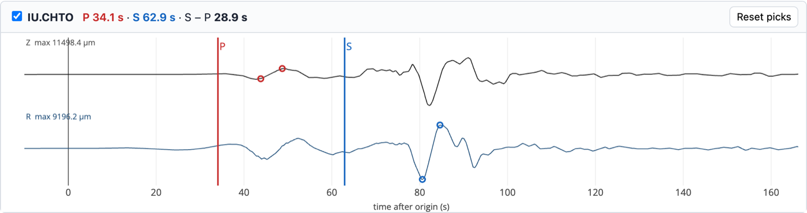
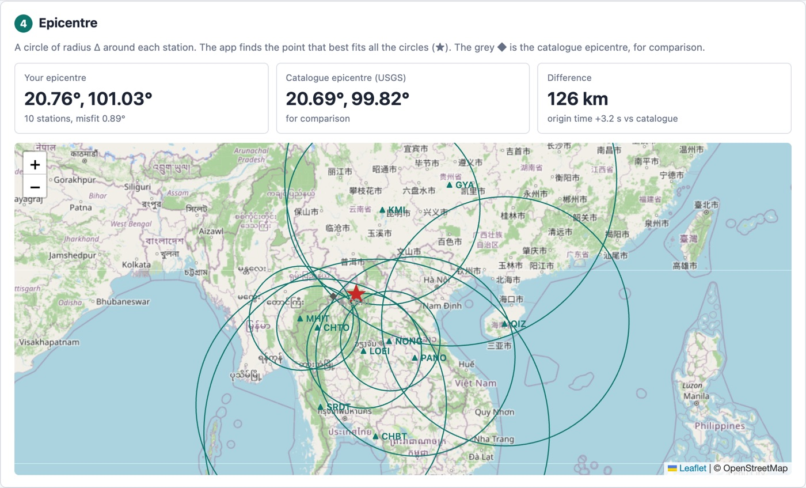

# Earthquake Calculator (Google Apps Script)

A web app for students: choose an earthquake, the app downloads real seismograms from
EarthScope (IRIS), picks the P and S arrivals, locates the epicentre from S − P times and
computes mb, Ms and the energy with the lecture formulas. Students check the automatic
picks, drag any wrong pick to the right place, and save their result to a Google Sheet.

Teaching material for the earthquake magnitude and epicentre exercises (KAGS305/KAGS392 and
Noise & Vibration), using five earthquakes that affected Thailand.

## Files

| File | What it does |
|---|---|
| `Code.gs` | Server side. Reads/writes the Google Sheet; asks USGS for earthquakes and EarthScope for stations and seismograms. At the bottom: the iasp91 travel-time table (P time and S − P, Δ = 0.1–20°, depths 10/35/80/150 km), copied to the sheet by `setup()`. |
| `Index.html` | The page students use. Decodes the seismograms (miniSEED), filters them, picks P/S, locates, computes magnitudes, draws plots and the map. |
| `appsscript.json` | Project settings (time zone, web-app access). Optional: only needed if you use `clasp`. |

## The Google Sheet

`setup()` creates four tabs:

- **Events**: the earthquakes students can choose. Five are filled in (Tarlay 2011, Mae Lao 2014, Chauk 2016, Mandalay 2025, Sumatra 2004). Students can add more from the USGS search in the app, or you can type rows yourself (origin time as `2011-03-24T13:55:12.010Z`).
- **TravelTimes**: the iasp91 table the app reads S − P distances from.
- **Settings**: search radius (default 20°, the table's limit), maximum number of stations (12) and similar.
- **Results**: one row per saved student result (name, epicentre, distance from USGS, mb, Ms, picks).

## Setting it up (about 10 minutes)

1. Create a new Google Sheet (e.g. "Earthquake Calculator").
2. **Extensions → Apps Script**. This opens a script project linked to the sheet.
3. In the editor:
   - Replace the contents of `Code.gs` with this `Code.gs`.
   - **+ → HTML**, name it `Index` (no `.html`), paste `Index.html`.
   - Save (Ctrl/Cmd + S).
4. Choose the function **`setup`** in the toolbar and click **Run** (if you skip this, the web app creates the tabs the first time it opens). Approve the permissions
   (the script needs your spreadsheet and "connect to an external service" for USGS/EarthScope).
   Go back to the sheet: the four tabs are there, and a new **Earthquake app** menu appears after reloading.
5. **Deploy → New deployment → ⚙ Web app**:
   - Execute as: **Me**
   - Who has access: **Anyone with a Google account** (or **Anyone within Mahidol University**)
   - Click **Deploy**, copy the web-app URL and give it to the students.
6. After changing the code later: **Deploy → Manage deployments → ✏ → Version: New version → Deploy**
   (the URL stays the same). To try changes before students see them, use **Deploy → Test deployments**.

## How the app works

1. `getInitData()` reads Events, TravelTimes and Settings.
2. `getSeismograms(event)` asks EarthScope for broadband (BH) stations within the search radius,
   keeps one complete Z/N/E set per site, and downloads 60 s before the origin until the Rayleigh
   wave has passed. Requests run in parallel (`UrlFetchApp.fetchAll`); stations whose data are not
   shared (e.g. recent Thai TMD records) are skipped. Takes 10–60 s.
3. In the browser, each record is decoded (Steim-1/2), divided by the channel sensitivity (counts → m/s),
   rotated to north/east, and filtered:
   - 1–5 Hz velocity for picking: P = STA/LTA trigger refined with the AIC picker; S = the same on the horizontal envelope between 1.55 and 1.95 × tP.
   - 0.05–2 Hz displacement in µm for the plots and amplitudes (as in the worksheet figures).
4. S − P → Δ from the travel-time table (interpolated to the catalogue depth). A grid search finds the
   point whose distance to each station best matches its Δ (the "circles" method). Records that are clipped are left out.
   Each seismogram has **Amplitude − +** and **Time − +** buttons; dragging across a plot zooms into
   that time window and double-click (or **Fit**) shows the whole record again. Zoom only changes the
   display: amplitudes and magnitudes always use the true values.
5. mb = log A − log T + 0.01Δ + 5.9 (largest P swing on Z), Ms = log A + 1.66 log Δ + 2.0 (largest swing after S on the radial component), E = 10^(5.24 + 1.44 Ms) J. Network value = median of the stations.

## What to expect (tested on the five earthquakes, automatic picks only)

| Earthquake | Stations | Epicentre error | mb | Ms | USGS |
|---|---|---|---|---|---|
| 2011 Tarlay | 10 | 126 km | 6.97 | 6.79 | Mww 6.9 |
| 2014 Mae Lao | 5 | 79 km | 6.01 | 5.86 | Mww 6.1 |
| 2016 Chauk (82 km deep) | 11 | 126 km | 6.81 | 5.90 | Mww 6.8 |
| 2025 Mandalay | 6 | 146 km | 6.66 | 7.25 | Mww 7.7 |
| 2004 Sumatra | 3 | 322 km | 7.57 | 8.21 | Mw 9.1 |

The epicentre improves when students correct the wrong S picks (red rows in the S − P table).
The magnitudes show the lecture's points: mb saturates for big earthquakes (Mandalay, Sumatra), Ms is
too small for the deep Chauk event, and both fall short of Mw for Sumatra.

## Limits

- Distances up to 20° only (the travel-time table and the S-pick search are regional).
- The instrument correction uses each channel's single sensitivity value, which is accurate for
  broadband sensors in the 0.05–2 Hz band but not outside it.
- Station data come only from EarthScope; networks that do not share data there are skipped.
- mb and Ms formulas are defined for 20°–160°; at regional distances they are approximations, as in the worksheet.
